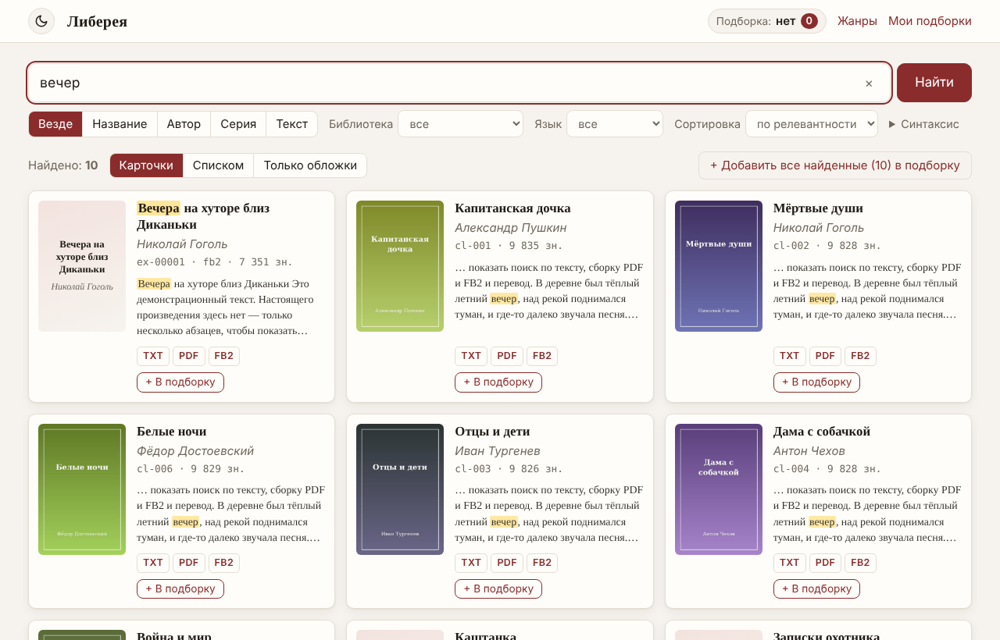
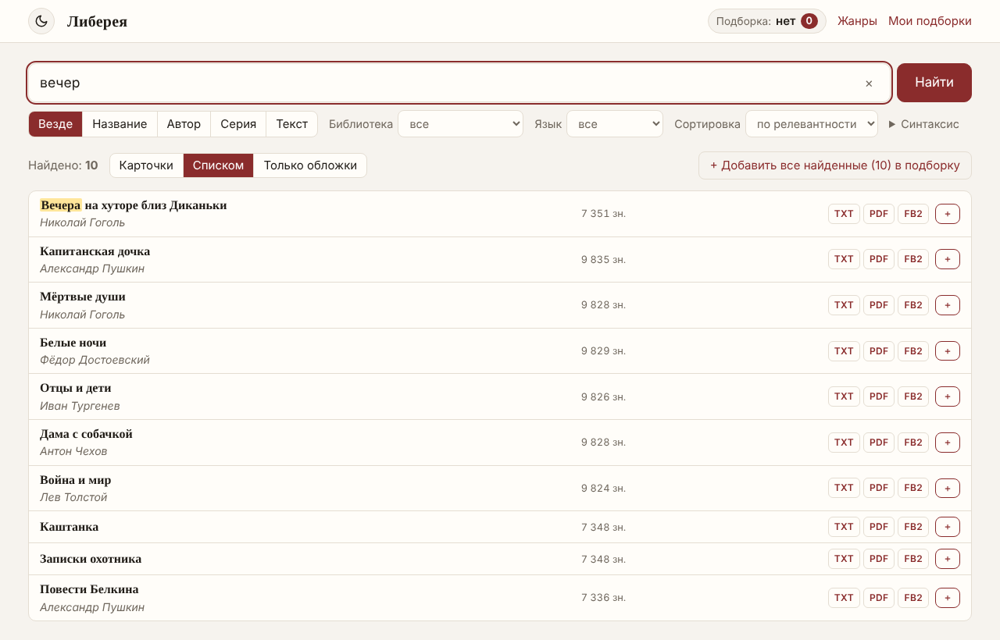
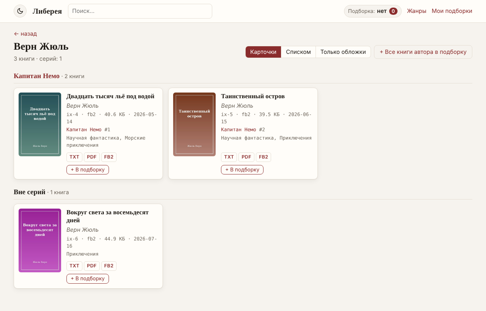
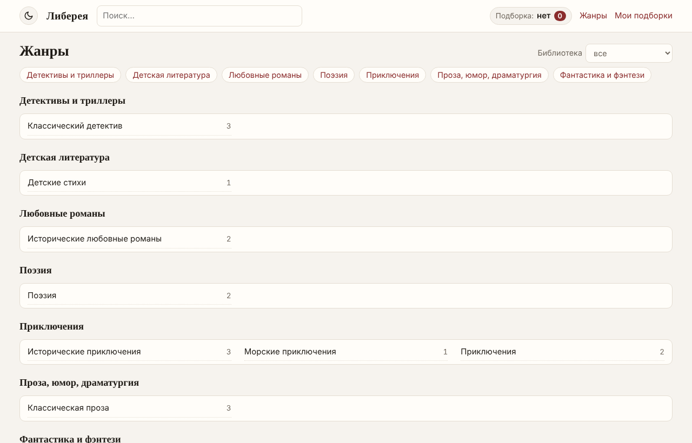
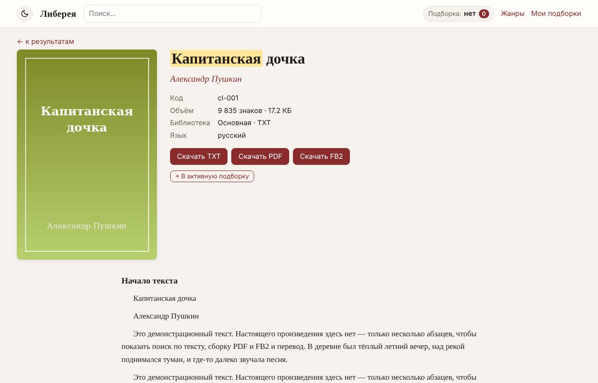
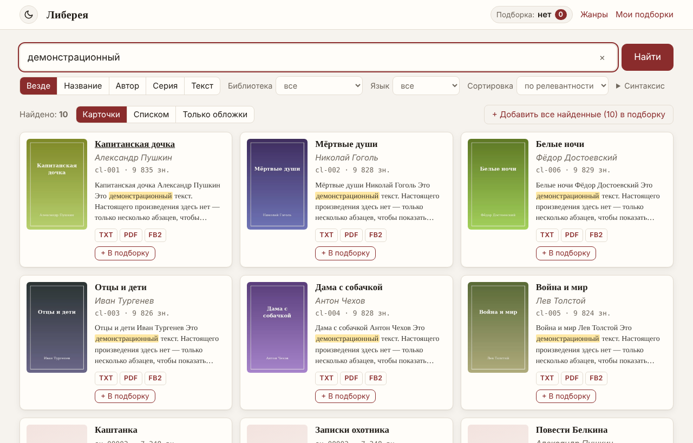
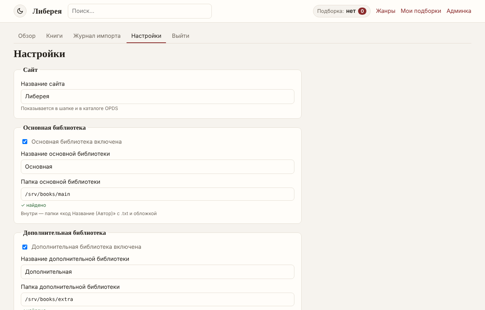

<p align="center"></p>

<h1 align="center">Либерея</h1>

<p align="center"><b>Домашний сервер электронной библиотеки</b> — поиск по тысячам книг, подборки в один PDF/FB2,
каталог OPDS для читалок и перевод английских книг. Работает в вашей локальной сети, без облаков.</p>

<p align="center">
  <a href="../../releases/latest">Скачать</a> ·
  <a href="docs/guide.md">Руководство</a> ·
  <a href="README.en.md">English</a> ·
  <a href="CHANGELOG.md">Изменения</a>
</p>



## Возможности

- **Три вида источников** в одном каталоге:
  - папки `код Название (Автор)` с текстом .txt и обложкой;
  - папка с файлами .txt / .fb2 в любых подпапках (с поиском дубликатов);
  - коллекции **INPX** (каталоги MyHomeLib) — сотни тысяч книг, импорт метаданных за минуты, книги читаются прямо из zip.
- **Поиск** по названию, автору, серии, коду и **полному тексту** — на русском и английском, с учётом словоформ
  (`деревня` найдёт «в деревне»), фразы, исключения, поиск по началу слова.
- **Авторы, серии, жанры:** списки с числом книг; у автора книги сгруппированы по сериям.
- **Три вида выдачи:** карточки, список, только обложки. **Тёмная и светлая тема.** Удобно с телефона.
- **Скачивание** TXT / PDF / FB2, для FB2-исходников — оригинальный файл.
- **Подборки:** собирайте книги из разных поисков и получайте **один PDF или FB2** с содержанием и обложками.
- **Каталог OPDS** — библиотека прямо в FBReader, Moon+ Reader, KOReader, CoolReader, ReadEra.
- **Перевод** английских книг на русский: локально и бесплатно (Argos / OPUS-MT), через Yandex Cloud или
  литературно — локальной языковой моделью (LM Studio, Ollama). Переведённые книги находятся русскими словами.
  Модели ставятся отдельно одной командой: `get-model.bat` или `get-model.bat --opus-big` — [подробнее](docs/guide.md#перевод-с-английского-на-русский).
- **Админка:** сканирование с прогрессом, журнал импорта, правка и скрытие книг, **настройки в браузере**,
  мастер первого запуска.

| | | |
|---|---|---|
|  |  |  |
|  |  |  |

## Быстрый старт

**Windows** — без установки Python:
1. Скачайте `Liberea-…-windows-x64.zip` из [Releases](../../releases/latest), распакуйте.
2. Запустите `run.bat` и откройте http://localhost:5555/setup — задайте пароль и папки с книгами.
3. Админка → **«Сканировать»**. Готово.

**Linux:**
```bash
tar xzf Liberea-*-linux.tar.gz && cd Liberea-*-linux
./packaging/linux/install.sh --service      # окружение Python + служба systemd
```
и откройте `http://<адрес>:5555/setup`.

**Docker** (amd64 / arm64):
```bash
docker run -d --name liberea --restart unless-stopped -p 5555:5555 \
  -v "$PWD/data:/data" -v /srv/books:/books:ro ghcr.io/icdev-ru/liberea:latest
```
В мастере первого запуска указывайте папки как `/books/...`. Есть [`docker-compose.yml`](docker-compose.yml).

**Попробовать без своих книг:** `python scripts/make_demo.py demo` создаст демо-библиотеку всех трёх видов.

С других устройств открывайте `http://<IP компьютера>:5555`, в читалке — каталог `http://<IP компьютера>:5555/opds`.
Подробности — в [руководстве](docs/guide.md).

> **Только для домашней сети.** Открытая часть Либереи не требует входа. Не публикуйте её в интернет напрямую —
> для доступа извне используйте VPN (WireGuard, Tailscale и т. п.).

## Из исходников

Нужен Python 3.11+.
```bash
git clone https://github.com/icdev-ru/liberea.git && cd liberea
python -m venv .venv && .venv/bin/pip install -r requirements.txt     # Windows: run.bat сделает это сам
.venv/bin/python manage.py serve
```
Тесты: `pip install -r requirements-dev.txt && python -m pytest -q`.

Устройство: Python + FastAPI, SQLite с полнотекстовым индексом FTS5 (стеммер Snowball), шаблоны Jinja2 и немного
JavaScript без фреймворков. Тексты книг не копируются в базу — индекс хранит только основы слов.

## Лицензия

[GPL-3.0](LICENSE). Шрифты DejaVu — [своя свободная лицензия](fonts/LICENSE-DejaVu.txt).
Модели перевода в состав не входят: они скачиваются отдельно и распространяются на условиях своих авторов
(Argos Translate, OPUS-MT / Helsinki-NLP — CC-BY 4.0).

Либерея — программа для **ваших** книг. В репозитории и сборках нет и не будет книг или каталогов коллекций.
